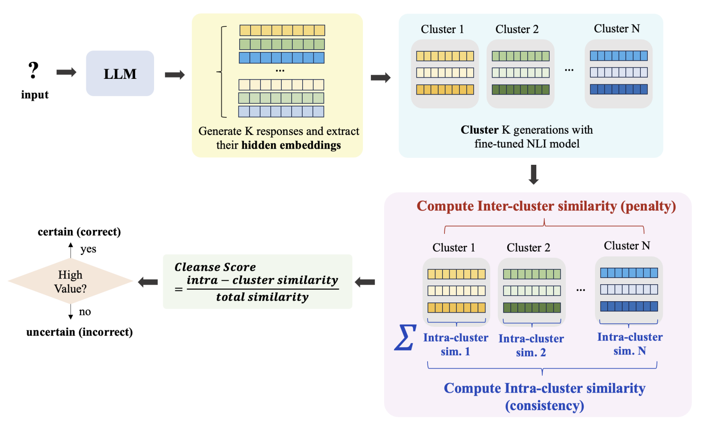
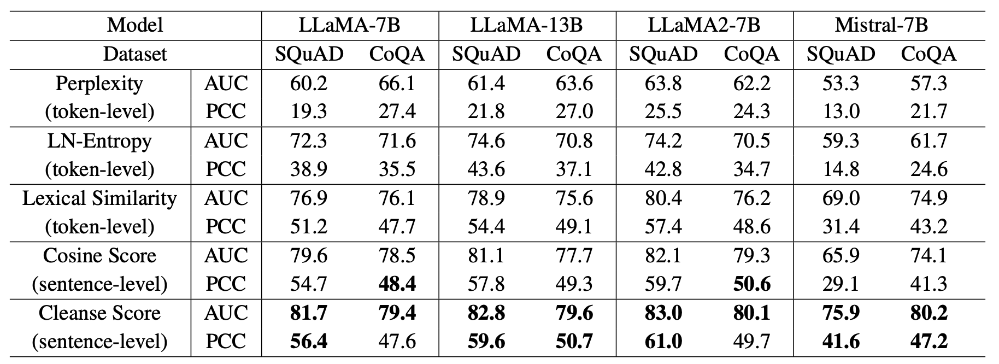

## 🧼 Cleanse: Uncertainty Estimation Approach Using Clustering-based Semantic Consistency in LLMs. 

Accepted to ACL 2025 GEM workshop (oral presentation)
[[paper]](https://aclanthology.org/2025.gem-1.25/)

### 1. Introduction

Large language models (LLMs) can generate fluent and confident responses even when their answers are incorrect. Estimating uncertainty is therefore essential for identifying potentially unreliable generations and improving the trustworthiness of LLMs. **Cleanse** is a clustering-based uncertainty estimation method that evaluates the semantic consistency of multiple responses generated for the same question. Inspired by the **Dunn Index**, Cleanse measures the separation between semantic clusters relative to their internal cohesion, capturing uncertainty beyond token-level probabilities or lexical similarity.

### 2. Method

<p align="center">
  
</p>

* **Step 1. Response Sampling**: Generate multiple responses to the same input question using an LLM and extract their hidden embeddings from the last token in the middle layer of model. 
* **Step 2. Semantic Clustering**: Group the generated responses into semantic clusters based on their meanings using NLI model rather than surface-level lexical overlap.
* **Step 3. Intra- and Inter-Cluster Similarity**: Measure two aspects of semantic consistency using extraced hidden embeddings from Step 1.
  * **Intra-cluster similarity**: How semantically consistent the responses are within each cluster. 
  * **Inter-cluster similarity**: How semantically similar or distinct the responses are across different clusters.
* **Step 4. Clustering-Based Uncertainty Estimation**: Compute an uncertainty score inspired by the Dunn Index, using the relationship between intra-cluster cohesion and inter-cluster separation. The resulting score characterizes the semantic consistency of the model's sampled responses and serves as a signal for identifying potentially unreliable answers.


This is the example of how Cleanse estimates the uncertainty. 

<p align="center">
  
</p>


### 3. Experiment Results

**Cleanse achieved higher AUROC than conventional uncertainty estimation baselines**, including perplexity, length-normalized entropy, and lexical similarity-based methods. 

<p align="center">
  
</p>

### How to implement 

```
git clone https://github.com/juminsuh/Cleanse.git
conda create -n cleanse python=3.10 -y
conda activate cleanse
# install appropriate version of torch for your GPU
pip install -r requirements.txt
```

Before install requirements, you should install appropriate version of torch which works at your GPU. Our settings were below:

| GPU Architecture | PyTorch | Torchvision | Triton | CUDA |
|---|---|---|---|---|
| Blackwell (RTX 50xx, RTX PRO 6000, B200, etc.) | 2.11.0 | 0.26.0 | 3.6.0 | 12.8+ |

Please change the directory for successful implementation w/o errors. You should check `settings.py`, `dataeval/coqa.py`, `dataeval/SQuAD.py`, `func/evalFunc.py`. 
Then, run the below code which downloads the clustering model, generates multiple outputs, extracts corresponding hidden states, forms clusters based on semantic consistency, computes the Cleanse Score, and reproduces our results. 

```
# download the clustering model
python -c "from transformers import AutoTokenizer, AutoModelForSequenceClassification as M; AutoTokenizer.from_pretrained('cross-encoder/nli-deberta-v3-base'); M.from_pretrained('cross-encoder/nli-deberta-v3-base')"

# run the full pipeline and evaluate results
bash run.sh
```

Base code is provided by <https://github.com/D2I-ai/eigenscore>
