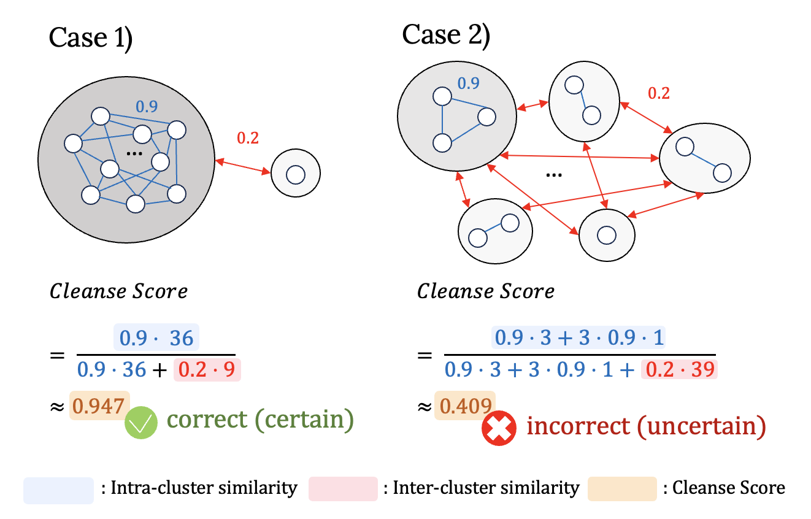

## 🧼 Cleanse: Uncertainty Estimation Approach Using Clustering-based Semantic Consistency in LLMs. 

Accepted to ACL 2025 GEM workshop (oral presentation)
[paper link](https://aclanthology.org/2025.gem-1.25/)

### 1. Introduction

Large language models (LLMs) can generate fluent and confident responses even when their answers are incorrect. Estimating uncertainty is therefore essential for identifying potentially unreliable generations and improving the trustworthiness of LLMs. **Cleanse** is a clustering-based uncertainty estimation method that evaluates the semantic consistency of multiple responses generated for the same question. Inspired by the **Dunn Index**, Cleanse measures the separation between semantic clusters relative to their internal cohesion, capturing uncertainty beyond token-level probabilities or lexical similarity.

## 2. Method




### How to implement 

```bash
pip install -r requirements.txt
```

```bash
sh run.sh
```
Base code is provided by <https://github.com/D2I-ai/eigenscore>
